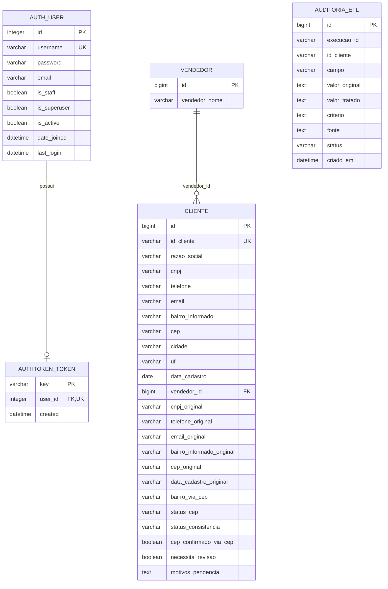
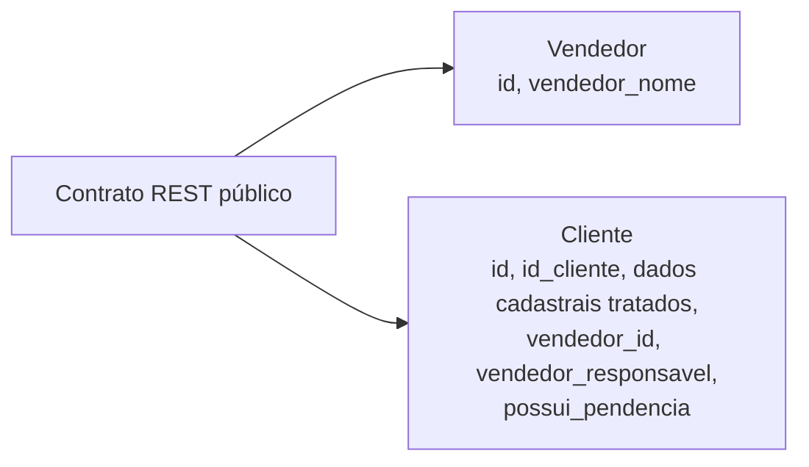

# Diagrama Entidade‑Relacionamento (DER)

Este DER representa a estrutura física conceitual utilizada pelo Django ORM no banco SQLite.

## Tabelas físicas

| Entidade | Tabela Django | Finalidade |
|---|---|---|
| Vendedor | `dados_cadastrais_vendedor` | Responsáveis comerciais |
| Cliente | `dados_cadastrais_cliente` | Cadastro tratado e informações internas |
| AuditoriaETL | `dados_cadastrais_auditoriaetl` | Histórico das transformações ETL |
| User | `auth_user` | Usuários Django |
| Token | `authtoken_token` | Tokens de autenticação REST |

## Relacionamentos e restrições

### Vendedor — Cliente

- **Tipo:** 1:N.
- **Chave estrangeira:** `dados_cadastrais_cliente.vendedor_id` → `dados_cadastrais_vendedor.id`.
- **Nomeção inversa:** `vendedor.clientes`.
- **Exclusão:** `PROTECT`; impede exclusão de um vendedor com clientes associados.
- **Campo técnico da API:** o cadastro aceita `vendedor_id` como identificador inteiro.

### Usuário — Token

- **Tipo:** 1:1 opcional.
- **Chave:** `authtoken_token.user_id` é único e referencia `auth_user.id`.
- **Uso:** o usuário envia nome e senha em `/api/auth/token/` e recebe a chave do token.
- **Autorização:** o token é enviado como `Authorization: Token <chave>`.

### Cliente — AuditoriaETL

- No modelo atual não existe chave estrangeira entre essas tabelas.
- O vínculo lógico é o campo textual `auditoriaETL.id_cliente` com `cliente.id_cliente`.
- Essa escolha preserva o histórico independentemente de recriação ou exclusão do cadastro.

## Índices previstos

| Campo | Índice / restrição |
|---|---|
| `cliente.id` | Chave primária |
| `cliente.id_cliente` | Único quando preenchido |
| `cliente.vendedor_id` | Índice automático de chave estrangeira |
| `auditoria_etl.execucao_id` | Índice para agrupar cargas |
| `auditoria_etl.id_cliente` | Índice para consulta histórica |
| `authtoken_token.user_id` | Único |

## Modelo lógico dos dados públicos

Os campos `_original`, `status_cep`, `status_consistencia`, `bairro_via_cep`, `cep_confirmado_via_cep`, `motivos_pendencia` e os demais detalhes internos não fazem parte do modelo público do serializer.
