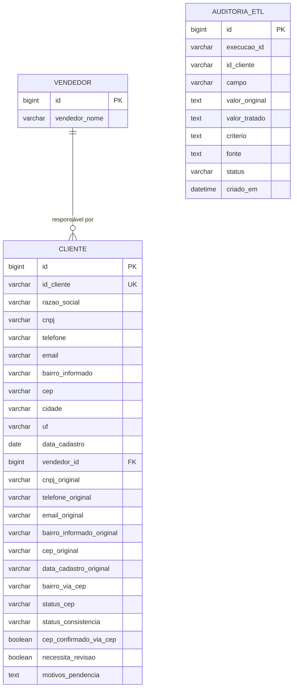

# Modelo Entidade‑Relacionamento (MER)

## Visão geral

O modelo organiza os cadastros operacionais e o rastreamento das cargas ETL da API da Distribuidora Vetor.

## Entidades

### VENDEDOR
Representa o responsável comercial pelos clientes.

| Atributo | Papel | Observação |
|---|---|---|
| `id` | Identificador | Chave primária técnica gerada pelo Django |
| `vendedor_nome` | Nome | Nome exibido nos cadastros e na API |

### CLIENTE
Representa uma unidade cadastral da Distribuidora Vetor.

| Atributo | Papel | Observação |
|---|---|---|
| `id` | Identificador técnico | Chave primária usada pelas rotas REST |
| `id_cliente` | Identificador de origem | Proveniente do CSV; único e estável para importações |
| `razao_social`, `cnpj`, `telefone`, `email` | Dados tratados | Valores normalizados apresentados pela API |
| `cidade`, `uf`, `cep`, `bairro_informado` | Localização | Dados cadastrais tratados |
| `data_cadastro` | Data tratada | Persistida como `DateField` |
| `vendedor_id` | Responsabilidade | Referência obrigatória a um vendedor |
| Campos `*_original` | Proveniência | Texto recebido na origem, preservado para rastreabilidade |
| Campos de qualidade | Diagnóstico interno | Não são publicados no contrato público da API |

### AUDITORIA_ETL
Registra eventos individuais produzidos em cada execução da carga. Não possui relação física por chave estrangeira com `CLIENTE`, porque é um histórico independente e pode preservar registros após mudanças ou exclusões de cadastros.

| Atributo | Papel | Observação |
|---|---|---|
| `execucao_id` | Grupo da execução | Agrupa todos os eventos de uma carga |
| `id_cliente` | Identificador da origem | Pode servir para rastrear o cliente sem limitar o histórico |
| `campo` | Campo alterado/avaliado | Exemplo: `cep`, `bairro_informado` |
| `valor_original` / `valor_tratado` | Transformação | Preserva entrada e saída da regra |
| `criterio` / `fonte` | Justificativa | Explica e identifica a origem da decisão |
| `status` | Resultado | Exemplo: `NORMALIZADO`, `CONFLITO` ou `PENDENCIA` |
| `criado_em` | Temporalidade | Preenchida automaticamente |

## Cardinalidades

- Um **Vendedor** pode estar associado a nenhum ou muitos **Clientes**: `1:N`.
- Um **Cliente** deve estar associado a exatamente um **Vendedor**.
- Uma execução ETL pode gerar muitos registros de **AuditoriaETL**.
- Um identificador de cliente pode estar associado a muitos eventos históricos ao longo das reexecuções.

## Regras de integridade

- `Vendedor.id` é gerado pelo Django.
- `Cliente.id_cliente` é único quando preenchido.
- `Cliente.vendedor_id` usa `PROTECT`: um vendedor não pode ser excluído enquanto houver clientes associados.
- `Cliente.cnpj` não é único no banco; a API impede duplicidade por valor numérico não mascarado durante criação ou atualização.
- `email` não é único, pois o conjunto pode conter e-mails compartilhados.
- Dados internos de qualidade e origem não aparecem no serializer público.
- Reexecuções do ETL atualizam clientes por `id_cliente` e inserem novos eventos históricos.

## Entidades de autenticação do Django

A API utiliza o mecanismo padrão do Django REST Framework e do módulo `rest_framework.authtoken`:

- `AUTH_USER`: usuário administrativo/autenticável.
- `AUTHTOKEN_TOKEN`: possui um token por usuário e se relaciona com `AUTH_USER` pela chave primária/usuário.

Essas entidades não são entidades de negócio; elas autenticam os usuários que podem alterar dados.
